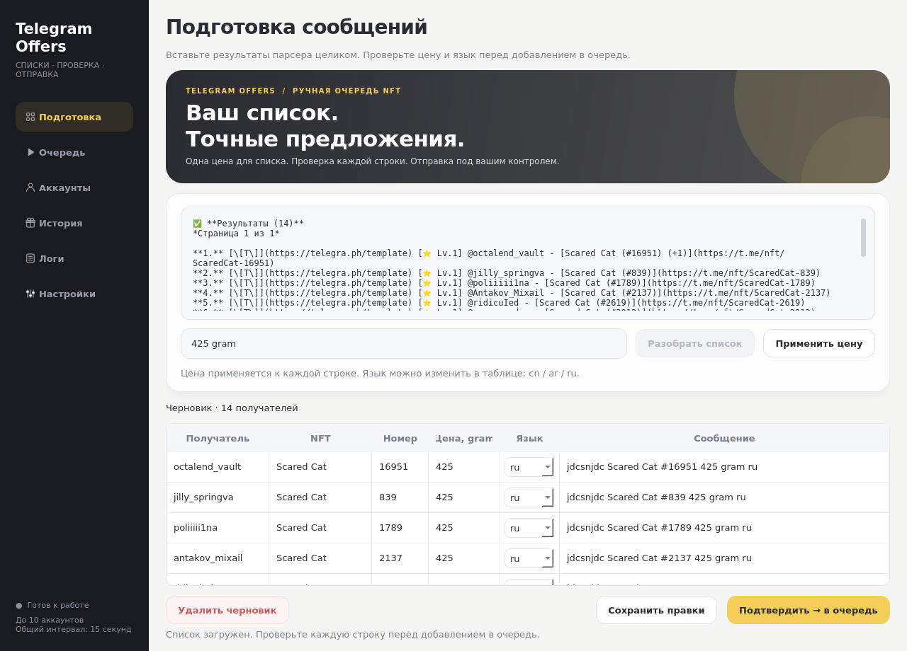

# Telegram Offers — списки и очередь NFT

Программа для подготовки и отправки предложений из готового списка. **Трекер рынка удалён.** Два способа управления одной очередью: окно программы (`desktop.py`) или Telegram-бот (`bot_runner.py`). Существующие сессии и история в `data` сохраняются.



## Запуск программы

Python 3.12+. Для Qt на Mac требуется macOS 13+.

```sh
python3 -m venv .venv
.venv/bin/python -m pip install -r requirements.txt
.venv/bin/python desktop.py
```

При обновлении остановите прежнюю программу и сохраните папку `data` целиком. Обновите все исходники и зависимости, затем запустите `desktop.py`. Старый поиск рынка, выбор коллекций, скидка в Stars и пробная рассылка заменены ручной подготовкой списка.

## Работа в окне

1. Откройте **Настройки**, введите API ID и API Hash с my.telegram.org/apps (или задайте `TG_API_ID` / `TG_API_HASH`). Ключи остаются в памяти окна.
2. В **Аккаунтах** подключите сохранённые сессии либо добавьте аккаунт: телефон → код Telegram → при необходимости пароль 2FA. До 10 слотов.
3. В **Подготовке** вставьте список `@username - https://t.me/nft/ScaredCat-1775` (одна строка — один NFT) или сообщение «✅ Результаты» из парсера целиком. Укажите общую итоговую цену, например `425 gram`, и нажмите **Разобрать список**. Если цена ещё не задана, список сохранится и будет ожидать её: заполните поле и нажмите **Применить цену**.
4. В таблице проверьте получателя, NFT, номер, цену и язык. Все эти поля редактируются; столбец «Сообщение» показывает итоговую команду. **Сохранить правки** сохраняет черновик. **Применить цену** меняет цену всех строк после сохранения ручных правок.
5. **Подтвердить → в очередь** сохраняет подготовленные сообщения. Откройте **Очередь** и нажмите **Начать отправку**. Если очередь уже работает, подтверждённые строки добавляются в её конец.

В **Очереди** доступны пауза, продолжение и стоп. Стоп сохраняет оставшиеся строки. **История** показывает получателей из общей базы, **Логи** — постоянный журнал. В настройках можно выбрать обложку.

Язык определяется по отображаемому имени Telegram: `cn` при китайских иероглифах, иначе `ar` при арабских символах, иначе `ru`. В таблице язык можно переопределить. Входная цена — готовая итоговая цена **для каждой строки списка**, без скидки и конвертации.

```text
Вход:
@username - https://t.me/nft/ScaredCat-1775

Общая цена: 425 gram
Сообщение: jdcsnjdc Scared Cat #1775 425 gram ru
```

Название восстанавливается из slug ссылки (`ScaredCat` → `Scared Cat`), номер — из её окончания. Проверьте название в таблице: нестандартные названия с апострофами могут потребовать ручной правки. При повторе username с разными NFT в очередь попадёт только первая строка, если получатель ещё не встречался в истории.

Заголовки, уровни, служебные ссылки и статистика игнорируются. Пометка `(+1)` не добавляет неизвестный NFT без номера. Также поддерживается ручной ввод `@username Scared Cat #16951 425 gram ru` (язык необязателен).

## Очередь и сохранение данных

Аккаунты назначаются по кругу. Общий интервал между попытками — не меньше **15 секунд**, включая разные аккаунты и перезапуски. Проверка повторов использует Telegram ID и username; прежняя история автоматически учитывается. Один получатель получает одно предложение, даже если указан другой NFT.

При закрытии программы оставшаяся очередь и черновик сохраняются. Для продолжения после запуска снова нажмите **Начать отправку**. Если процесс оборвался во время запроса Telegram, запись получает неопределённый результат и автоматически не повторяется. Ошибки также не запускаются повторно. После FloodWait очередь останавливается; соблюдайте указанный в логе срок ожидания. PeerFlood отдельно учитывается по аккаунтам.

Не запускайте окно и Telegram-бота одновременно с одной папкой `data`: общий процессный замок защищает сессии и очередь. Для переключения завершите текущий процесс. Храните `data` приватно и сохраняйте её при обновлении.

## Управление через Telegram-бота

Полная инструкция: [BOT_SETUP.md](BOT_SETUP.md). Бот принимает те же списки и цену, предлагает предпросмотр и ручную правку, использует те же базу, сессии, интервал и историю. Токен нужен только для управления через бота.

```sh
.venv/bin/python bot_runner.py
```

## Проверки

```sh
.venv/bin/python -m unittest discover -v
```

Тесты проверяют разбор результатов, цены, языки, редактирование таблицы, восстановление окна, очередь, историю старой базы, отдельное подтверждение, интервал и вход с 2FA. Telegram-клиенты подменены: реальные сообщения не отправляются. В Linux без экрана задайте `QT_QPA_PLATFORM=offscreen`.
